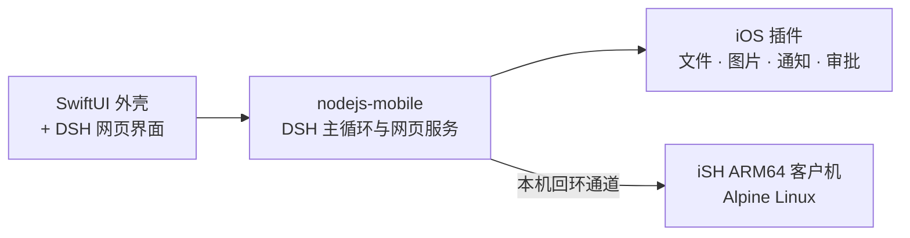
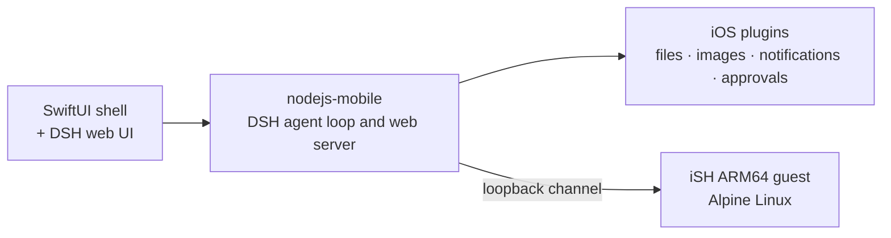

<div align="center">

# dsh-apple

**把 DeepSeek Harness 完整搬到 iPhone 和 iPad 上：不需要 Mac，也不需要远程服务器。**

**DeepSeek Harness on iPhone and iPad, with no Mac and no remote server.**


[中文](#中文) · [English](#english)

</div>

> [!WARNING]
> 这是 [DeepSeek Harness](https://www.npmjs.com/package/@deepseek-ai/dsh) 的非官方移植，与 DeepSeek 无关。项目处于试验阶段，没有现成的安装包，需要自己编译、签名。使用前请先读[安全说明](#安全说明)。
>
> This is an unofficial port of [DeepSeek Harness](https://www.npmjs.com/package/@deepseek-ai/dsh), not affiliated with DeepSeek. It is experimental and has no prebuilt app; you build and sign it yourself. Read [Security](#security) first.

---

## 中文

### 现状

这份代码在干净目录里从头构建过，在 iOS 27 模拟器上测试过；同一份代码在一台 iPhone 15 Pro Max（iOS 27.2）上能运行。其他设备没有测过，iPad 只在模拟器上跑过。

### 它在 iOS 上怎么跑起来

iOS App 不能开子进程，也不能用 JIT，所以平常那套“Node 进程加一个 shell”的结构，被整个塞进了一个 App 进程里：



| 层 | 位置 | 作用 |
|---|---|---|
| Node 运行时 | `vendor/`（构建时下载）、`app/DSHPortC/NodeRunner.swift` | `nodejs-mobile` 在 App 的一个线程里跑 DSH 的智能体循环和网页服务 |
| 兼容垫片 | `sim/` | 补上内嵌 Node 缺的 `fetch`、`TextDecoder`、`Intl` 和文件锁 |
| Linux 客户机 | `ish/`、`app/DSHPortC/ISHGuest*` | iSH ARM64 模拟器启动一个 Alpine 镜像，命令都是真的 Linux 命令 |
| 客户机通道 | `app/DSHPortC/ISHGuestChannel*`、`plugins/dsh-subprocess-ish` | 用本机回环通道把 DSH 原来开子进程的地方换成客户机进程 |
| iOS 插件 | `plugins/` | 按 iOS 改写的文件工具、沙箱、图片、通知和审批 |
| DSH 本体 | `payload/`、`profiles/` | 上游 npm 包、一个小补丁和 iOS 配置 |
| App 外壳 | `app/DSHPortC/` | 包着网页界面的 SwiftUI 外壳 |

[`PATCHES.md`](PATCHES.md) 列出了对上游代码的每一处改动，以及升级后怎么复查。脚本和注释里还留着开发时的工作编号（比如“step 7”），提到的 `REPORT-*` 文档不在本仓库里。

### 构建

需要一台 Apple 芯片的 Mac，装好：

- Xcode，带 iOS 26 或更新的 SDK（测试用的是 iOS 27 SDK 和模拟器）
- Node 和 npm（测试用 Node 24）、Python 3、带 `gem` 的 Ruby、`git`、`curl`、`unzip`、`jq`
- `meson`、`ninja` 和 LLVM 的 `ld.lld`
- `libarchive`，例如 `brew install libarchive jq meson ninja lld`

`scripts/toolchain.sh` 会在 `PATH` 里找这些工具，也可以用 `MESON=`、`NINJA=`、`LLD=`、`CC_TOOL=` 指定。

```sh
scripts/bootstrap.sh
```

它会下载 Node 运行时、npm 包和 iSH 源码，按固定的哈希或提交号校验，然后构建客户机镜像，再编译模拟器版 App。客户机镜像里的 Alpine 软件包没有锁定版本，以后重新构建可能装上更新的版本。

**在模拟器上运行：** 先启动一台模拟器，再安装刚编好的 App：

```sh
xcrun simctl install booted DerivedData/Build/Products/Debug-iphonesimulator/DSHPortC.app
xcrun simctl launch booted local.dshportc.app
```

**装到真机：** 跑完 `scripts/bootstrap.sh` 后，用你自己的 Apple 开发者团队：

```sh
DSH_TEAM_ID=<你的团队 ID> scripts/build-device.sh
xcrun devicectl device install app --device <设备 ID> DerivedData/Build/Products/Debug-iphoneos/DSHPortC.app
```

设备 ID 用 `xcrun devicectl list devices` 查。设备要打开开发者模式；第一次打开 App 时，要在“设置 → 通用 → VPN 与设备管理”里信任你的开发者证书。

如果你的团队用不了默认的 App 标识符，改 `scripts/gen-xcode-project.rb` 里的 `BUNDLE_ID`，同时把 `app/DSHPortC/Info.plist` 和 `app/DSHPortC/BackgroundContinuation.swift` 里的后台任务标识符改成对应的值，不然后台续跑会失效。

App 最低支持 iOS 17，但只在 iOS 27 上实际跑过。iOS 26 以下没有后台续跑。

验收脚本会加载 `scripts/device.sh`，它用一组单独的模拟器（iOS 27 上的 iPhone 17），换别的系统版本要改这个文件。

### 配置

App 里不带任何 API 密钥。在 App 设置里添加模型服务商和密钥即可，模型请求从设备直接发到服务商。

### 安全说明

请按“模型能访问这个 App 的全部数据”来对待它。

- **默认权限模式是 `danger-full-access`。** iOS 没办法限制客户机里的命令，所以更严格的模式会直接拒绝执行命令。
- **文件工具碰不到密钥和 App 自己的状态文件，除此之外在这个模式下没有路径限制。** 围栏挡住了 DSH 的密钥文件和 `.env` 文件、`storages/` 目录和 App 的 `DSHPortC/` 目录，判断前会先解析符号链接、`..` 和大小写变体。客户机里的 shell 也看不到这些目录：它们没有挂进客户机，客户机自己也挂不了宿主目录。
- **API 密钥存在一个明文文件里**，没有放进钥匙串。上面的围栏测过，但不是真正的沙箱：被网页或项目里某个文件误导的模型，仍有可能拿到密钥并发出去。请用能随时作废、设了消费上限的密钥。这个文件也属于 App 数据，会跟对话一起进 iCloud 备份和电脑备份。
- **审批弹窗只是提醒，不是防线。** 它只拦 `rm` 这类几个字面写出来的 `bash` 命令。用 Python 删文件、用重定向清空文件、用写入工具改文件，都不会弹。
- 不要把无法恢复的文件放进工作区。

### 已知限制

- 冷启动要好几秒，JavaScript 还没有打包。
- iOS 挂起 App 时，长回合可能被打断。
- 客户机是模拟出来的，重活会慢。客户机里的 `node`、`npm`、`python3` 是试验性的，没有 `pip`、编译器和包管理器。
- iPad 只在模拟器上跑过。

### 测试

管道分行的 Swift 测试需要装有完整 Xcode 的 macOS，在仓库根目录运行：

```sh
(
  set -e
  dsh_platform="$(xcrun --sdk macosx --show-sdk-platform-path)"
  dsh_frameworks="$dsh_platform/Developer/Library/Frameworks"
  dsh_swift_libs="$dsh_platform/Developer/usr/lib"
  dsh_test_dir="$(mktemp -d)"
  trap 'rm -f -- "$dsh_test_dir/tests"; rmdir -- "$dsh_test_dir"' EXIT
  xcrun --sdk macosx swiftc -swift-version 5 -parse-as-library \
    -F "$dsh_frameworks" -I "$dsh_swift_libs" -L "$dsh_swift_libs" -framework XCTest \
    -Xlinker -rpath -Xlinker "$dsh_frameworks" \
    -Xlinker -rpath -Xlinker "$dsh_swift_libs" \
    app/DSHPortC/PipeLineBuffer.swift tests/node-runner/PipeLineBufferTests.swift \
    -o "$dsh_test_dir/tests"
  "$dsh_test_dir/tests"
)
```

```sh
node --test tests/fetch/*.cjs tests/fetch/*.mjs tests/step19/*.test.mjs tests/subprocess/*.test.mjs tests/fs-fence/*.test.mjs tests/mobile-web/*.test.mjs
```

这会跑单元测试：`fetch` 替代实现的重定向处理、启动保护、安全模式、重置和诊断逻辑、命令工作目录的选择、文件工具的围栏，以及移动端草稿聚焦。Node 24 在这里不接受只写目录名。

分发产物验收单独运行，需提供已经构建的 Debug 和最终 Release（或 Archive 内的）App：

```sh
DSH_DEBUG_APP=DerivedData/Build/Products/Debug-iphonesimulator/DSHPortC.app \
DSH_RELEASE_APP=DerivedData/Build/Products/Release-iphonesimulator/DSHPortC.app \
node --test tests/distribution/*.test.mjs
```

未设置对应路径的用例会跳过，跳过不代表产物通过。测试会对主程序和 NodeMobile 执行 `nm -u`；若发现时钟或磁盘 API 缺少声明，须审阅对应源码并由作者确认理由代码，不能只按符号填代码。

待办 `G:ASR-001-DiskSpace`：审阅最终构建所用的 iSH `statfs` 透传、NodeMobile `fs.statfs` 调用及结果用途，再选择适用的 `85F4.1`、`E174.1` 或其他理由并补入清单。当前未声明磁盘空间类别，ASR-001 仅部分修复；含相关符号的产物仍会验收失败。

日志追加的 Swift 测试也在装有完整 Xcode 的 macOS 上、从仓库根目录运行：

```sh
(
  set -e
  dsh_platform="$(xcrun --sdk macosx --show-sdk-platform-path)"
  dsh_frameworks="$dsh_platform/Developer/Library/Frameworks"
  dsh_swift_libs="$dsh_platform/Developer/usr/lib"
  dsh_test_dir="$(mktemp -d)"
  trap 'rm -f -- "$dsh_test_dir/tests"; rmdir -- "$dsh_test_dir"' EXIT
  xcrun --sdk macosx swiftc -swift-version 5 -parse-as-library \
    -F "$dsh_frameworks" -I "$dsh_swift_libs" -L "$dsh_swift_libs" -framework XCTest \
    -Xlinker -rpath -Xlinker "$dsh_frameworks" \
    -Xlinker -rpath -Xlinker "$dsh_swift_libs" \
    app/DSHPortC/BootLogFile.swift tests/node-runner/BootLogFileTests.swift \
    -o "$dsh_test_dir/tests"
  "$dsh_test_dir/tests"
)
```

`mock/` 是一个本地假模型服务。`scripts/*acceptance*` 和 `app/DSHPortCUITests/` 是验收测试，其中有几个是按某台机器的模拟器环境写的，可能要设 `DSH_DEVICE_UDID` 或调整路径。

状态快照的 Swift 测试启用 Thread Sanitizer；同样需要完整 Xcode，在仓库根目录运行：

```sh
(
  set -e
  dsh_platform="$(xcrun --sdk macosx --show-sdk-platform-path)"
  dsh_frameworks="$dsh_platform/Developer/Library/Frameworks"
  dsh_swift_libs="$dsh_platform/Developer/usr/lib"
  dsh_test_dir="$(mktemp -d)"
  trap 'rm -f -- "$dsh_test_dir/tests"; rmdir -- "$dsh_test_dir"' EXIT
  xcrun --sdk macosx swiftc -swift-version 5 -parse-as-library -sanitize=thread \
    -F "$dsh_frameworks" -I "$dsh_swift_libs" -L "$dsh_swift_libs" -framework XCTest \
    -Xlinker -rpath -Xlinker "$dsh_frameworks" \
    -Xlinker -rpath -Xlinker "$dsh_swift_libs" \
    app/DSHPortC/LockedValue.swift tests/node-runner/LockedValueTests.swift \
    -o "$dsh_test_dir/tests"
  "$dsh_test_dir/tests"
)
```

### 许可与分发

Copyright (C) 2026 dsh-apple contributors。采用 GPL-3.0：App 链接了 iSH 模拟器内核，所以整个 App 都是 GPL-3.0。各组件的条款见 [`THIRD_PARTY_NOTICES.md`](THIRD_PARTY_NOTICES.md)，客户机镜像里的软件包见 [`RootfsPackages.md`](RootfsPackages.md)。

给自己的设备签名安装不算分发。把安装包给任何别人都算分发，包括通过 TestFlight 或 App Store：对方必须能拿到那个构建对应的完整源码，包括客户机软件包的对应源码和镜像构建脚本。仓库提供 App 本体和构建脚本；镜像 `alpine-3.21.0-2e1ec684ab529225`（0.2.1 的 build 21、22 所带）的 Alpine 对应源码归档在 [Releases](https://github.com/2570165831/dsh-apple/releases/tag/guest-sources-alpine-3.21.0-2e1ec684ab529225)。重建镜像后须按 `THIRD_PARTY_NOTICES.md` 第 4 节另出一份再分发。

构建会内置 `LICENSE`、`THIRD_PARTY_NOTICES.md`、`RootfsPackages.md` 和整个 `LICENSES/`，入口是双指长按打开的调试菜单中的“关于与许可”。页面包含 iSH 两份许可说明，并列出补入的 npm 和客户机许可正文。这个隐藏入口的存在不代表已确认满足 GPL §5(d) 对法律声明展示的要求，分发前仍须核对。`LICENSES/ISH-LICENSE.IOS` 只处理 GPL 和 App Store 条款之间的冲突。

npm 和客户机的许可正文、版权声明仍待取得，收集要求见 `LICENSES/npm/README.md`、`LICENSES/rootfs/README.md`。默认获取 payload、生成客户机镜像和 Debug 构建只报告缺件并警告，四列表和镜像仍会生成，便于继续开发和收集材料。损坏或不完整的数据库捕获仍会停止镜像导出。

分发构建必须设置 `DSH_REQUIRE_NOTICES=1`：获取 payload、生成镜像时作为环境变量传入，调用 `xcodebuild` 时显式传入同名构建设置；项目生成器也会读取该环境变量。Xcode 的 Release 配置或 install/archive 动作自动严格检查，不能用 `0` 关闭。旧镜像和历史清单可供默认 Debug 开发使用，但分发前须重建，取得数据库捕获和哈希记录并补齐正文。检查通过仍不代表对应源码归档已经完成。

---

## English

### Status

This code has been built from a clean checkout and tested on the iOS 27 simulator,
and the same code runs on one iPhone 15 Pro Max with iOS 27.2. It has not been
tested on other devices, and iPad has only been exercised in the simulator.

### How it runs on iOS

iOS apps cannot start child processes or use a JIT, so the usual "Node process
plus shell" setup is rebuilt inside a single app process:



| Layer | Where | What it does |
|---|---|---|
| Node runtime | `vendor/` (fetched), `app/DSHPortC/NodeRunner.swift` | `nodejs-mobile` runs the DSH agent loop and web server on a thread of the app |
| Compatibility shims | `sim/` | `fetch`, `TextDecoder`, `Intl` and file-lock replacements the embedded Node lacks |
| Linux guest | `ish/`, `app/DSHPortC/ISHGuest*` | An iSH ARM64 emulator boots an Alpine image, so a shell command is a real Linux command |
| Guest channel | `app/DSHPortC/ISHGuestChannel*`, `plugins/dsh-subprocess-ish` | Loopback bridge that replaces DSH's `child_process` use with guest processes |
| iOS plugins | `plugins/` | File tools, sandbox, images, notifications and approvals adapted to iOS |
| DSH itself | `payload/`, `profiles/` | The upstream npm packages, a small patch and the iOS profile |
| App shell | `app/DSHPortC/` | SwiftUI shell around the web UI |

[`PATCHES.md`](PATCHES.md) (Chinese) lists every change to upstream code and how to
re-check it after an upgrade. Scripts and comments still refer to the numbered work
items ("step 7") the project was built in, and to `REPORT-*` documents that are not
part of this repository.

### Building

Requires an Apple Silicon Mac with:

- Xcode with the iOS 26 SDK or newer (tested with the iOS 27 SDK and simulator)
- Node and npm (tested with Node 24), Python 3, Ruby with `gem`, `git`, `curl`,
  `unzip` and `jq`
- `meson`, `ninja` and LLVM's `ld.lld`
- `libarchive`, for example `brew install libarchive jq meson ninja lld`

`scripts/toolchain.sh` finds the build tools on `PATH` or through `MESON=`,
`NINJA=`, `LLD=` and `CC_TOOL=`.

```sh
scripts/bootstrap.sh
```

This downloads the Node runtime, the npm packages and the iSH sources, checks them
against pinned hashes or commits, builds the guest image and builds the app for the
simulator. The Alpine packages in the guest image are not pinned, so a later
rebuild can contain newer versions.

**Simulator:** boot one and install the app the bootstrap built:

```sh
xcrun simctl install booted DerivedData/Build/Products/Debug-iphonesimulator/DSHPortC.app
xcrun simctl launch booted local.dshportc.app
```

**Device:** after `scripts/bootstrap.sh`, using your own Apple developer team:

```sh
DSH_TEAM_ID=<your team id> scripts/build-device.sh
xcrun devicectl device install app --device <device id> DerivedData/Build/Products/Debug-iphoneos/DSHPortC.app
```

`xcrun devicectl list devices` shows the device id. The device must be in Developer
Mode, and the first launch asks you to trust your developer certificate in
Settings → General → VPN & Device Management.

If the default identifier is unavailable to your team, change `BUNDLE_ID` in
`scripts/gen-xcode-project.rb`, and the background task identifier in
`app/DSHPortC/Info.plist` and `app/DSHPortC/BackgroundContinuation.swift` to match.
Otherwise background continuation stops working.

The app's minimum system is iOS 17, but it has only been run on iOS 27. Below
iOS 26 there is no background continuation.

The acceptance scripts load `scripts/device.sh`, which uses a private simulator set
with an iPhone 17 on the iOS 27 runtime. Edit it for other runtimes.

### Configuration

The app ships no API key. Add a provider and key in the app's settings. Models
reach the provider directly from the device.

### Security

Treat the model as having full access to this app's data.

- **The default permission mode is `danger-full-access`.** iOS gives no way to
  confine the guest's commands, so the stricter modes refuse commands instead.
- **File tools are fenced off from the credentials and the app's own state, and
  have no other path limit in this mode.** The fence covers DSH's credential and
  `.env` files, its `storages/` directory and the app's `DSHPortC/` directory, and
  resolves symlinks, `..` and case variants before deciding. The guest shell does
  not see those directories: they are not mounted in the guest, and the guest
  cannot mount host directories itself.
- **API keys are stored in a plain file**, not in the Keychain. The fences above
  are tested, but they are not a sandbox: treat a stored key as one that a model
  misled by a web page or a file in your project could still get to and send out.
  Use a key you can revoke, with a spending limit. The file is also part of the
  app's data, so it goes into iCloud and computer backups of the device along with
  your conversations.
- **Approval prompts are a convenience, not a boundary.** They match a few literal
  `bash` commands such as `rm`. Deleting a file from Python, truncating it with a
  redirect or using the write tool does not ask.
- Do not put files you cannot replace in the workspace.

### Known limits

- Cold start takes several seconds; the JavaScript is not bundled yet.
- Long turns can be interrupted when iOS suspends the app.
- The guest is emulated, so heavy commands are slow. `node`, `npm` and `python3`
  in the guest are experimental; there is no `pip`, compiler or package manager.
- iPad has only been exercised in the simulator.

### Tests

```sh
node --test tests/fetch/*.cjs tests/fetch/*.mjs tests/step19/*.test.mjs tests/subprocess/*.test.mjs tests/fs-fence/*.test.mjs tests/mobile-web/*.test.mjs
```

runs the unit tests: the `fetch` replacement's redirect handling, the start-up
guard, safe mode, reset and diagnostics logic, how a command's working directory is
chosen, the file tools' fence, and mobile draft focus. Node 24 does not accept a
bare directory here.

Distribution artifact acceptance runs separately on macOS:

```sh
DSH_DEBUG_APP=DerivedData/Build/Products/Debug-iphonesimulator/DSHPortC.app \
DSH_RELEASE_APP=DerivedData/Build/Products/Release-iphonesimulator/DSHPortC.app \
node --test tests/distribution/*.test.mjs
```

Use the final Release or Archive app for `DSH_RELEASE_APP`. Tests without the
corresponding path are skipped; a skip is not artifact acceptance. The clock and
disk symbol check runs `nm -u` on the executable and NodeMobile. Missing
declarations need a source audit and author-confirmed reasons, not guesses from
symbol names.

Follow-up `G:ASR-001-DiskSpace`: audit the final build's iSH `statfs` forwarding,
NodeMobile `fs.statfs` calls and the uses of their results before adding `85F4.1`,
`E174.1` or another applicable reason. The disk-space category is still undeclared;
ASR-001 is only partially fixed, and artifacts using these APIs still fail acceptance.

`mock/` is a local fake model server. `scripts/*acceptance*` and
`app/DSHPortCUITests/` are the acceptance tests. Several were written for one
machine's simulator setup and may need `DSH_DEVICE_UDID` or path adjustments.

### License and distribution

Copyright (C) 2026 dsh-apple contributors. GPL-3.0: linking the iSH emulator core
makes the whole app GPL-3.0. Each component's terms are in
[`THIRD_PARTY_NOTICES.md`](THIRD_PARTY_NOTICES.md), and
[`RootfsPackages.md`](RootfsPackages.md) lists the packages in the guest image.

Signing it for your own device is not distribution. Giving a copy to anyone else,
including through TestFlight or the App Store, is: the recipient must be able to get
the complete corresponding source for that exact build, including the guest
packages' source and the image build scripts. This repository provides the app
source and build scripts. The Alpine corresponding-source archive for image
`alpine-3.21.0-2e1ec684ab529225` (the image in 0.2.1 builds 21 and 22) is under
[Releases](https://github.com/2570165831/dsh-apple/releases/tag/guest-sources-alpine-3.21.0-2e1ec684ab529225).
A rebuilt image needs its own archive, as described in section 4 of
`THIRD_PARTY_NOTICES.md`, before it is distributed.

The build bundles `LICENSE`, `THIRD_PARTY_NOTICES.md`, `RootfsPackages.md` and the
whole `LICENSES/` tree. Open About and Licences (关于与许可) from the debug menu
with a two-finger long press. It includes both iSH notices and lists supplied
npm and guest license texts. This hidden entry alone is not a claim that the
notices meet GPL §5(d); review their presentation before distribution.
`LICENSES/ISH-LICENSE.IOS` covers only the conflict between the GPL and the
App Store terms.

npm and guest license texts and copyright notices still need to be obtained;
see `LICENSES/npm/README.md` and `LICENSES/rootfs/README.md`. By default, payload
fetching, rootfs generation and Debug builds report missing material as warnings.
The four-column inventory and image are still produced for development and
notice collection. A broken or incomplete database capture still stops export.

Distribution builds must set `DSH_REQUIRE_NOTICES=1`: pass it as an environment
variable when fetching payloads or generating images, and explicitly as a build
setting to `xcodebuild`. The project generator also reads that environment
variable. Xcode Release configurations and install/archive actions enforce
strict checks regardless of a value of `0`. Default Debug builds can use old
images and historical inventories with warnings; distribution requires a
rebuild with the database capture, hash record and complete notice files.
Passing these checks does not supply a corresponding-source archive.
